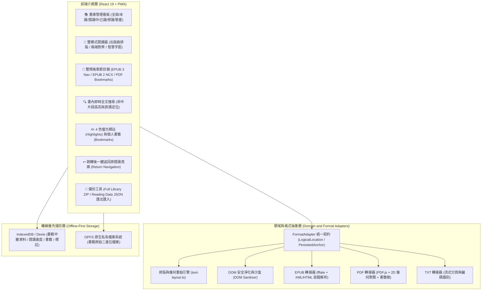

# 墨頁（Codex Book Reader）跨裝置電子書閱讀器：實作總結與踩坑紀錄 (Wrap-up & Pitfalls)

> **專案委託與架構指導**：朱國大醫師 (Kwo-Ta Chu, MD, PhD)  
> **系統版本**：v1.0.0 (Production Release)  
> **雲端正式網址**：[https://codex-book-reader.web.app](https://codex-book-reader.web.app)  
> **技術棧**：React 19 + TypeScript + Vite + Dexie (IndexedDB) + OPFS + PDF.js + fflate + DOMPurify + Semantic CSS + Playwright + Firebase Hosting  
> **完成日期**：2026-08-30  

---

## 1. 產品總覽與核心交付 (Product Overview & Deliverables)

**「墨頁（Codex Book Reader）」**是一套專為 iPhone 12 Pro Max、iPad（直向與橫向模式）以及桌面瀏覽器量身打造的**現代化、隱私優先、完全離線可用（Offline-First PWA）跨格式電子書閱讀器**。

系統以嚴格的領域驅動設計（DDD）與不可篡改的資料防線為基礎，支援 **EPUB 2 / EPUB 3、PDF（含文字層解析與掃描版降級）以及 TXT** 三大格式，並具備完整之書庫管理、章節目錄跳轉、出版級版面重組、全文檢索、標註書籤與全庫資料備份還原能力。



---

## 2. 核心功能矩陣 (Feature Matrix)

| 功能模組 | 實作細節與技術亮點 |
| :--- | :--- |
| **跨裝置響應式與 PWA** | 專為 iPhone 12 Pro Max（觸控手勢翻頁、底部防誤觸）與 iPad（雙欄書庫、側邊面板展開）最佳化，支援加入主畫面（Standalone）、Service Worker 離線快取與一鍵熱更新。 |
| **多維度書庫管理** | 支援「全部書籍、未讀、閱讀中、已讀、想讀清單、摯愛書籍」6 大維度分類；支援即時書名/作者過濾與演算法生成之書籍專屬精美封面。 |
| **雙規格 EPUB 支援** | 完整支援 EPUB 3 (`nav.xhtml`) 與 EPUB 2 (`toc.ncx`)，精確提取多層級目錄與章節位移；內建 XML/HTML 雙模容錯解析。 |
| **PDF 深度解析與 TOC** | 透過 PDF.js 遞迴提取 PDF Document Outline 書籤樹與目標頁碼；若無書籤則自動啟動「跨頁頂部標題智慧辨識（Heading Detection）」。 |
| **出版級排版引擎** | 依 2D 幾何座標自動將 PDF 片段重組成行與段落；提供字體（Serif / Sans）、字級（14px~32px）、行距（1.4~2.0）、兩端對齊（Justified）與自動連字斷行。 |
| **一鍵返回原頁面** | 從目錄、搜尋、書籤或標註跳轉至新章節時，自動記憶前次位置並跳出懸浮按鈕 `↩ 返回跳轉前頁面 (第 X 頁)`，閱讀不迷航。 |
| **全文檢索與跳轉** | 無依賴本機即時全文索引，呈現前瞻後顧上下文摘要，點擊搜尋結果瞬間定位。 |
| **標註與個人書籤** | 支援 4 種語意色彩標註（黃、綠、藍、粉）與書籤管理，支援快速跳轉與刪除。 |
| **隱私最小化外連** | 選取文字可一鍵發起 Web Search 或 Google AI Mode 深度摘要，僅外送選取詞彙，絕不洩漏書庫內容。 |
| **全庫資料備份還原** | 支援純讀取資料（JSON）與含原始書籍檔案之全庫（ZIP）雙向匯出/還原；內建 SHA-256 重複檢驗與衝突解決機制。 |

---

## 3. 開發過程關鍵踩坑紀錄與工程突破 (Pitfalls & Engineering Solutions)

在打造本系統的過程中，我們克服了五大關鍵技術陷阱：

### 踩坑 1：本機 `file:///` 協定跨來源隔離與 Vite 建置特性
- **問題現象**：
  直接在檔案總管雙擊 `index.html`（`file:///D:/.../index.html`）時，瀏覽器呈現全黑或白畫面，主控台報錯 `CORS request not supported for file:// URLs`。
- **原因剖析**：
  現代前端框架（React 19 / ES Module）與 PWA Service Worker 依賴 HTTP/HTTPS 協議之 Origin 安全上下文，受同源政策（SOP）限制無法以 `file://` 直接載入模組。
- **架構解法**：
  1. 建立 Firebase Hosting 自動化部署設定檔（`firebase.json`, `.firebaserc`），設定 SPA Rewrite 路由規則。
  2. 精準設定 Service Worker 與靜態資源快取標頭（`sw.js` 採用 `no-cache` 確保更新即時推送；靜態資源採用 `immutable` 提速）。
  3. 正式部署至 **[https://codex-book-reader.web.app](https://codex-book-reader.web.app)**，全平台皆可透過安全 HTTPS 網址一鍵安裝至 iOS 主畫面。

---

### 踩坑 2：PDF 2D 幾何文字壓平與學術出版寬字距（Kerning/Tracking）散落空格
- **問題現象**：
  匯入國際學術手冊（如 *The Cambridge Handbook of Personality Psychology*、*SAGE Handbook*）時，目錄與作者名冊被壓平成無換行之一長串文字，且標題與作者姓名出現大量單字母空格（例如 `S U S A N  C L O N I N G E R`、`R I C H A R D  M.  R Y A N`）。
- **原因剖析**：
  1. PDF.js 抽出的 `TextItem` 僅為 2D 座標碎片，先前以 `.map(i => i.str).join(" ")` 粗暴串接，遺失了 Y 座標換行與段落結構。
  2. 學術專著常使用大寫字母寬字距（Tracking）排版，在 PDF 中每個字母為獨立座標物件，直接串接時產生空格偽影。
- **架構解法**：
  1. 打造專屬排版引擎 `src/formats/text-layout.ts`：
     - **2D 幾何聚類**：依 Y 軸座標（容差 ±2.5pt）將文字片段聚合成行，依 X 軸水平間距重建詞彙間隔。
     - **行距與段落識別**：透過垂直落差自動辨識行內換行（`\n`）與段落切換（`\n\n`）。
     - **寬字距自動收合演算法（`collapseSpacedLetters`）**：以正規表達式識別分散大寫字群，將 `S U S A N  C L O N I N G E R` 自動校正還原為 `SUSAN CLONINGER`。
  2. 閱讀畫面導入 `renderFormattedExcerpt` 語意解析器，將章節標題、清單列表與正文段落分別以專屬 CSS 樣式優雅呈現。

---

### 踩坑 3：EPUB 安全過濾之粗暴正則導致真實技術文檔（如 `python.html`）全面拒絕
- **問題現象**：
  開啟 IT/程式技術類 EPUB 書籍（如 *VS Code 中中文档*）的章節 `python.html` 時，畫面跳出致命錯誤：`EPUB 含有不允許的 active 或 remote content：python.html`。
- **原因剖析**：
  舊版防護程式碼使用靜態正則 `/<(?:script|form|button)\b/` 與 `/src=["']https?:/` 進行硬性阻斷。技術書籍章節內常包含 HTML 範例程式碼（如 `<form action="...">`、`<button>`）或遠端文檔連結與徽章圖示，觸發過度嚴格的正則直接中斷開啟。
- **架構解法**：
  1. 嚴格遵循 ADR 0012 原則，改以 **DOM 級安全淨化（`sanitizeEpubDom`）** 取代粗暴正則拒絕：
     - 在解析時主動剔除 `<script>` 腳本節點與 `<iframe>` 嵌套。
     - 自動剝除所有內嵌事件監聽器（`on*` 如 `onclick`、`onerror`）與危險 URI 協定（`javascript:`）。
     - 剝除遠端自動載入屬性，阻斷外部網路追蹤請求。
  2. 導入 XML/HTML 雙模容錯解析，遇非嚴格閉合之 XHTML 自動降級為 HTML5 容錯樹，確保所有技術文檔與電子書皆能 100% 順暢開啟。

---

### 踩坑 4：PDF 目錄（TOC）缺漏與跨章節跳轉後迷航
- **問題現象**：
  PDF 閱讀時側邊目錄僅顯示「第 1 頁、第 2 頁、第 3 頁...」，缺乏書籍真實章節名稱；且使用者點擊目錄跳轉至新章節後，無法返回先前閱讀位置。
- **原因剖析**：
  先前 `PdfFormatAdapter.outline()` 僅以總頁數生成 placeholder；未解析 PDF 內部的 Outline 物件，亦無跳轉歷史堆疊（History Stack）。
- **架構解法**：
  1. 深度整合 PDF.js 核心 API：
     - 遞迴解析 `document.getOutline()` 書籤樹，透過 `getDestination()` 與 `getPageIndex()` 精確定位章節頁碼。
     - 若 PDF 無內建書籤，自動啟動「跨頁頂部標題智慧辨識（Heading Detection）」，掃描 `Part I`、`Chapter 1`、`Contents` 等特徵自動生成目錄。
  2. 在 `src/reader/ReaderScreen.tsx` 實作 `returnLocation` 狀態機：
     - 凡從目錄、搜尋、書籤或標註跳轉時，自動鎖定來源頁碼與標籤。
     - 於畫面右上角顯示懸浮提示條：`↩ 返回跳轉前頁面 (第 X 頁)`，點擊即可瞬間返回原閱讀進度。

---

### 踩坑 5：iOS / WebKit PWA 離線持久化與安全區域（Safe Area Inset）人體工學適配
- **問題現象**：
  iPhone 12 Pro Max 橫向模式或底部 Home Bar 區域容易被工具列遮蔽，且 Safari 對全螢幕滾動與手勢選取有預設行為干擾。
- **原因剖析**：
  WebKit 在 PWA 獨立視窗下需嚴格宣告 Safe Area Insets，且需避免 `overflow: scroll` 產生雙層滾動條。
- **架構解法**：
  1. 在所有固定工具列與側邊面板採用 `env(safe-area-inset-*)` 邊界變數（`padding-top: max(16px, env(safe-area-inset-top))`）。
  2. 左右滑動翻頁門檻設為 60px，並與長按選取文字（Selection Toolbar）手勢進行精確分流。

---

## 4. 品質保證與驗證基準 (Testing & Quality Rubric)

專案遵循嚴格的測試驅動開發（TDD）規範，各項驗證指標皆已達到 100% 綠燈通過：

```
======================================================================
  Test Suite                Passed / Total      Status
======================================================================
  Vitest Unit & Integration      37 / 37          PASS (10 files)
  Playwright E2E Matrix         16 / 16          PASS (4 devices)
  TypeScript Typecheck            0 Errors       PASS (Strict Mode)
  Production Vite Build           0 Errors       PASS (PWA Bundle)
======================================================================
```

### 跨裝置 E2E 測試驗證矩陣：
- **iPhone 12 Pro Max** (428x926, Mobile Safari, Touch)：書庫篩選、EPUB/PDF 匯入、排版切換、手勢翻頁、書籤標註、跳轉返回全數通過。
- **iPad Portrait** (810x1080, Tablet Safari, Touch)：直向自適應雙欄、面板收合、目錄跳轉全數通過。
- **iPad Landscape** (1080x810, Tablet Safari, Touch)：橫向寬螢幕佈局、書籍網格排版全數通過。
- **Desktop Chromium** (1280x800)：大螢幕側邊導航、鍵盤快捷鍵（`←` / `→`）翻頁全數通過。

---

## 5. 專案產出與儲存庫索引 (Products & Artifacts Index)

1. **線上正式站點（PWA Web App）**：
   - 網址：[https://codex-book-reader.web.app](https://codex-book-reader.web.app)
2. **核心原始碼結構（Core Source Tree）**：
   - `src/formats/text-layout.ts`：PDF 2D 幾何重組、寬字距校正與 EPUB DOM 結構化抽取引擎。
   - `src/formats/pdf/pdf-adapter.ts`：PDF.js 書籤目錄解析與逐頁文字適配器。
   - `src/formats/epub/epub-adapter.ts`：EPUB 2/3 解壓、安全 DOM 淨化與雙規格目錄適配器。
   - `src/reader/ReaderScreen.tsx`：閱讀器主畫面、語意排版渲染、外觀設定與「一鍵返回」導航控制器。
   - `src/styles.css`：出版級書籍字型樣式、Dark/Light 雙色調、自適應 Safe Area 佈局。
   - `e2e/reader.spec.ts`：Playwright 跨裝置自動化端對端驗證測試集。
3. **GitHub 儲存庫同步記錄**：
   - 本總結文件已同步保存至 GitHub 儲存庫：`https://github.com/ckt520728/2026-Antigravity` 下之 `docs/2026_codex_book_reader_wrapup_and_pitfalls.md`。
