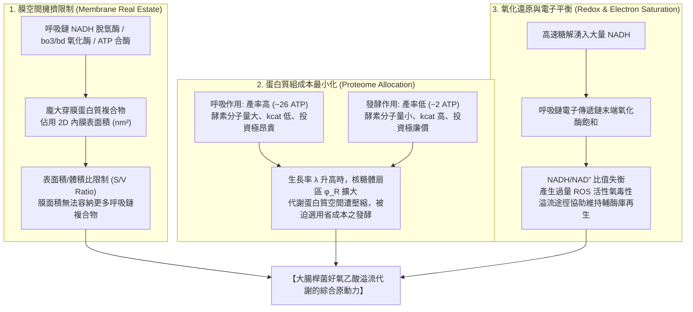
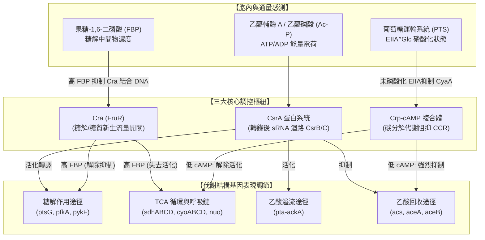
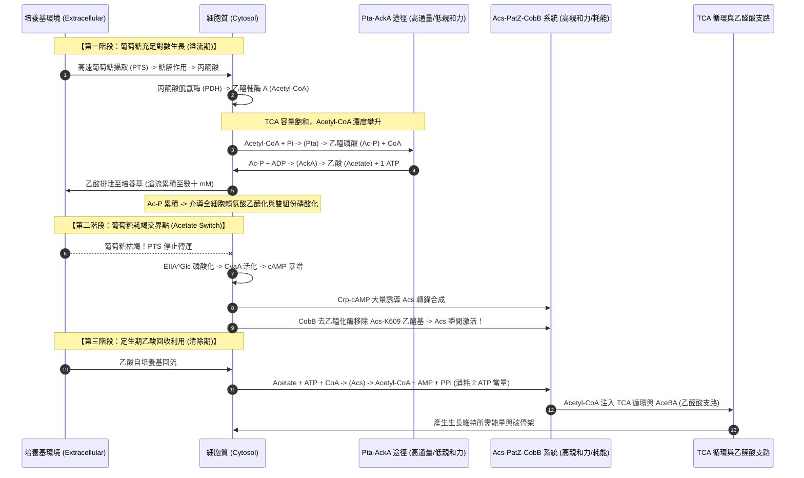

# 大腸桿菌溢流代謝、蛋白質組分配理論與調控網絡綜合研究報告
### (Overflow Metabolism, Proteome Allocation Theory, and Regulatory Networks in *Escherichia coli*)

---

## 一、 執行摘要與核心科學問題 (Executive Summary)

大腸桿菌（*Escherichia coli*）在好氧條件且碳源充足時，會放棄能量產率極高的完全呼吸作用（TCA 循環與電子傳遞鏈氧化磷酸化，約 26~32 ATP/葡萄糖），轉而將大量碳通量轉化為副產物——乙酸（Acetate）並排泄至胞外。這種在充足氧氣下進行不完全氧化或發酵的生理現象，稱為**溢流代謝（Overflow Metabolism）**，亦被視為細菌版本的 **Crabtree 效應** 或腫瘤細胞的 **Warburg 效應**。

本報告整合計算系統生物學、粗粒化生物物理模型、定量蛋白質組學與分子遺傳學，深入剖析：
1. **10 篇關鍵里程碑文獻矩陣**（定量多體學、生理生長定則、細胞經濟學）。
2. **三大主流假說之系統性物理比較**：膜空間擁擠限制（Membrane Space Limitation）、蛋白質組成本最小化（Proteome Cost Minimization）、氧化還原/電子平衡限制（Redox/Electron Saturation）。
3. **粗粒化蛋白質組扇區分配數學模型之嚴格推導**：推導 $\phi_R, \phi_M, \phi_F, \phi_Q$ 扇區分割、臨界生長速率 $\lambda_c$ 的解析解，並以生物物理經濟學證明發酵途徑（Pta-AckA）低 ATP 產率卻具備極低蛋白質投資成本的適應性優勢。
4. **三大樞紐調控網絡**：Crp-cAMP（碳代謝阻抑與通量感測）、Cra（FBP 糖解通量感測）、CsrA（轉錄後小 RNA 迴路）之交互對話架構。
5. **Acetate Switch 雙向開關機制**：低親和力高通量 Pta-AckA 乙酸排泄、高能中間產物乙醯磷酸（Acetyl-phosphate）信號傳導，以及高親和力 ATP 耗損型 Acs 乙酸回收利用與 PatZ/CobB 轉譯後乙醯化修飾調節。

---

## 二、 10 篇關鍵里程碑文獻矩陣 (Milestone Literature Matrix)

| 序號 | 論文標題 | 第一作者 / 期刊 / 年份 | PMID / DOI | 研究方法與技術平台 | 核心結論與科學貢獻 |
|:---|:---|:---|:---|:---|:---|
| 1 | **Overflow metabolism in Escherichia coli results from efficient proteome allocation** | Basan M et al. *Nature* (2015) | **PMID**: [26632588](https://pubmed.ncbi.nlm.nih.gov/26632588/) **DOI**: [10.1038/nature15765](https://doi.org/10.1038/nature15765) | 定量標靶蛋白質組學、連續培養化學恆定器（Chemostat）、氯黴素轉譯抑制滴定、粗粒化蛋白質分配模型 | 確立蛋白質組經濟學理論：發酵產能單位 ATP 所需酵素質量遠低於呼吸鏈；高生長速率下核糖體擴增迫使細胞轉向省蛋白質的發酵途徑，推翻酵素缺陷假說。 |
| 2 | **Shifts in growth strategies reflect tradeoffs in cellular economics** | Molenaar D et al. *Mol Syst Biol* (2009) | **PMID**: [19888218](https://pubmed.ncbi.nlm.nih.gov/19888218/) **DOI**: [10.1038/msb.2009.82](https://doi.org/10.1038/msb.2009.82) | 數學自我複製細胞模型（Self-fabricating cell）、幾何表面積體積比物理約束、酵素動力學分析 | 提出「膜空間擁擠假說（Membrane real estate）」：內膜表面積有限，無法容納高生長率所需的呼吸鏈穿膜複合物，促使細胞使用細胞質可溶性發酵酵素。 |
| 3 | **Why Do Fast-Growing Bacteria Enter Overflow Metabolism? Testing the Membrane Real Estate Hypothesis** | Szenk M et al. *Cell Syst* (2017) | **PMID**: [28864700](https://pubmed.ncbi.nlm.nih.gov/28864700/) **DOI**: [10.1016/j.cels.2017.06.005](https://doi.org/10.1016/j.cels.2017.06.005) | 穿膜呼吸鏈結構生物學、電子顯微鏡膜面積測量、2D 膜蛋白封裝密度與通量平衡分析 | 實測呼吸鏈複合物在內膜之物理投影面積；證實膜空間與細胞質 3D 體積擁擠存在雙重物理瓶頸，高生長率下膜充填率達物理飽和。 |
| 4 | **Interdependence of Cell Growth and Gene Expression: Origins and Consequences** | Scott M et al. *Science* (2010) | **PMID**: [21097934](https://pubmed.ncbi.nlm.nih.gov/21097934/) **DOI**: [10.1126/science.1192588](https://doi.org/10.1126/science.1192588) | 穩態生長速率調控、轉譯抑制、絕對 RNA/蛋白質定量分析 | 創立細菌生理生長三大法則（Bacterial Growth Laws）；將蛋白質組分割為核糖體扇區 $\phi_R$、代謝扇區 $\phi_C$ 與維持扇區 $\phi_Q$；$\phi_R$ 隨生長速率線性增加。 |
| 5 | **Coordination of bacterial proteome with metabolism by cyclic AMP signalling** | You C et al. *Nature* (2013) | **PMID**: [23925119](https://pubmed.ncbi.nlm.nih.gov/23925119/) **DOI**: [10.1038/nature12446](https://doi.org/10.1038/nature12446) | 質譜定量蛋白質組學、碳分解代謝阻抑（CCR）遺傳滴定、細胞內代謝通量分析 | 證明 cAMP 合成率為糖解 PTS 通量感測器；Crp-cAMP 迴路動態調節代謝扇區大小，提供粗粒化模型與轉錄調控之間的分子對應。 |
| 6 | **The acetate switch** | Wolfe AJ *Microbiol Mol Biol Rev* (2005) | **PMID**: [15755952](https://pubmed.ncbi.nlm.nih.gov/15755952/) **DOI**: [10.1128/MMBR.69.1.12-50.2005](https://doi.org/10.1128/MMBR.69.1.12-50.2005) | 生化途徑重構、熱力學反應自由能分析、酶動力學常數比較、生理學綜述 | 系統闡明 Acetate Switch 概念：對數生長依賴 Pta-AckA 排泄乙酸並產 1 ATP；對數末期依賴高親和力 Acs 消耗 ATP 逆向回收乙酸；揭示乙醯磷酸（Ac-P）信號功能。 |
| 7 | **Systems biology approach reveals that overflow metabolism of acetate in Escherichia coli is triggered by carbon catabolite repression of acetyl-CoA synthetase** | Valgepea K et al. *BMC Syst Biol* (2010) | **PMID**: [21122111](https://pubmed.ncbi.nlm.nih.gov/21122111/) **DOI**: [10.1186/1752-0509-4-166](https://doi.org/10.1186/1752-0509-4-166) | A-stat 加速恆化培養、轉錄組微陣列、2D-PAGE 蛋白質組、13C 代謝通量分析 | 證實 Crp-cAMP 介導之碳代謝阻抑使 Acs 嚴格關閉，避免 Pta-AckA 與 Acs 形成無效循環（Futile cycle）；TCA 飽和與 Acs 阻抑共同引爆乙酸溢流。 |
| 8 | **Proteome reallocation in Escherichia coli with increasing specific growth rate** | Peebo K et al. *Mol Biosyst* (2015) | **PMID**: [25712329](https://pubmed.ncbi.nlm.nih.gov/25712329/) **DOI**: [10.1039/c4mb00721b](https://doi.org/10.1039/c4mb00721b) | 絕對定量 LC-MS/MS SWATH-蛋白質組學（8 種不同稀釋率之恆化培養） | 實驗測得隨生長率上升，TCA 循環與呼吸鏈酵素在蛋白質組中佔比持續下降，糖解與核糖體蛋白佔比顯著上升；實證蛋白質組再分配。 |
| 9 | **Multidimensional optimality of microbial metabolism** | Schuetz R et al. *Science* (2012) | **PMID**: [22556256](https://pubmed.ncbi.nlm.nih.gov/22556256/) **DOI**: [10.1126/science.1216882](https://doi.org/10.1126/science.1216882) | 13C 代謝通量分析、多目標帕雷托最優化（Pareto optimality）通量平衡模型 | 揭示大腸桿菌代謝在「最大碳轉化率」與「最小酵素合成投資」雙目標帕雷托前沿運作；高生長率時自然演化強烈偏好最小酵素投資。 |
| 10 | **Overcoming acetate in Escherichia coli recombinant protein fermentations** | Eiteman MA & Altman E *Trends Biotechnol* (2006) | **PMID**: [16971006](https://pubmed.ncbi.nlm.nih.gov/16971006/) **DOI**: [10.1016/j.tibtech.2006.09.001](https://doi.org/10.1016/j.tibtech.2006.09.001) | 工業發酵工程分析、質子動力勢（PMF）解偶聯熱力學、基因工程敲除策略 | 闡明乙酸跨膜擴散導致胞內酸化、解偶聯氧化磷酸化、抑制甲硫氨酸合成之毒性機轉；提出敲除 pta-ackA、添加甘油等生化工程解法。 |

---

## 三、 溢流代謝三大主流假說之系統性物理與生理學比較

溢流代謝的發生並非單一因素所致，學界經過數十年探索，提出了三種互補的生物物理與生物化學假說：

### 三大假說特徵對比表

| 比較維度 | 假說一：膜空間擁擠限制 (Membrane Real Estate) | 假說二：蛋白質組成本最小化 (Proteome Allocation) | 假說三：氧化還原與電子平衡限制 (Redox/Electron Saturation) |
|:---|:---|:---|:---|
| **核心提倡文獻** | Molenaar et al. (2009), Szenk et al. (2017) | Basan et al. (2015), Scott et al. (2010) | Vemuri et al. (2006), de Graef et al. (1999) |
| **物理/生理瓶頸** | 細胞內膜 2D 表面積有限；表面積/體積比（$S/V$）隨細胞體積增大而下降。 | 細胞可溶性總蛋白質組容量（$1 - \phi_Q$）受限；核糖體隨生長率擴增擠壓代謝酵素空間。 | 電子傳遞鏈（ETC）電子通量容量飽和；呼吸鏈氧化容量上限導致 NADH 無法即時氧化。 |
| **能量產生機制比較** | 呼吸鏈複合物（NADH-1, Cytochrome *bo*₃, $F_1F_0$-ATPase）體積龐大；發酵酵素全為胞質可溶蛋白。 | 呼吸鏈單位 ATP 產率需 3~4 倍酵素質量；Pta-AckA 單位 ATP 產率之酵素成本極低。 | 呼吸鏈飽和導致胞內 NADH/NAD⁺ 比值急升，引發代謝阻滯與氧化應激（ROS）。 |
| **對外在擾動之預測** | 改變細胞形狀（如球形突變體減小 $S/V$）會提前誘發溢流。 | 人為過度表現無功能「垃圾蛋白」或加入微量轉譯抑制劑，會直接在更低生長率觸發溢流。 | 提高通氣氧分壓或外加人工電子受體可推遲或緩解溢流。 |
| **實驗檢驗結果** | 證實高生長率時內膜蛋白質充填率高達 60% 以上；但無法單獨解釋為何限制碳源時不溢流。 | **預測與實驗高度吻合**：Basan et al. 證明人為表現 10% 垃圾蛋白可使乙酸溢流起始生長率自 0.7 降至 0.45 $\text{h}^{-1}$。 | 確實在極高通量下觀察到 NADH 堆積，但單純供給高氧無法阻止高生長率下的乙酸排泄。 |

---

## 四、 粗粒化蛋白質組扇區分配數學模型之嚴格推導 (Mathematical Modeling)

本模型基於 Hwa 實驗室經典粗粒化生長法則（Scott et al., 2010; Basan et al., 2015），將大腸桿菌所有蛋白質質量按功能劃分為四大互斥扇區（Sectors）：

$$1 = \phi_R + \phi_M + \phi_F + \phi_Q$$

- $\phi_R$：**核糖體扇區（Ribosomal sector）**，包含核糖體結構蛋白、轉譯因子（EF-Tu、EF-G 等）及轉譯相關輔助蛋白質。
- $\phi_M$：**呼吸能量代謝扇區（Respiration sector）**，包含 TCA 循環各酵素、電子傳遞鏈複合物及 ATP 合酶。
- $\phi_F$：**發酵溢流代謝扇區（Fermentation sector）**，包含糖解過量通量處理酵素、磷酸轉乙醯酶（Pta）及乙酸激酶（AckA）。
- $\phi_Q$：**管家維持扇區（Housekeeping/Core sector）**，維持細胞基本結構與 DNA/膜修復所必需之蛋白質比例，實驗測得約為恆定值：$\phi_Q \approx 0.45 \sim 0.50$。

### 1. 細菌生長基本法則（Bacterial Growth Laws）

細胞生物量（Biomass）增長速率為 $\lambda$。生物質主要由蛋白質構成，因此總蛋白質合成速率必須匹配生長速率：

$$\lambda = \kappa_t \cdot (\phi_R - \phi_R^0)$$

即核糖體扇區與生長速率成嚴格正比關係：
$$\phi_R(\lambda) = \phi_R^0 + \frac{\lambda}{\kappa_t}$$
其中：
- $\phi_R^0 \approx 0.05$ 為非活性/基礎核糖體質量分數。
- $\kappa_t \approx 4.5 \sim 5.0\text{ h}^{-1}$ 為核糖體之最大轉譯伸長速率常數（與胜肽鍵合成速率直接相關）。

因此，留給所有「能量代謝酵素」的可用蛋白質份額 $\phi_{\text{metabolic}} = \phi_M + \phi_F$ 受到強烈擠壓約束：
$$\phi_M + \phi_F = (1 - \phi_Q - \phi_R^0) - \frac{\lambda}{\kappa_t} = \Delta \phi_{\max} - \frac{\lambda}{\kappa_t}$$
令 $\Phi_0 \equiv \Delta \phi_{\max} = 1 - \phi_Q - \phi_R^0 \approx 0.45$。

### 2. 代謝產能方程式與單位通量蛋白質成本

令能量貨幣 ATP 的生成通量為 $J_{ATP}$。合成單位生物質所需的 ATP 消耗係數為 $\sigma$（包括胜肽鍵合成與維持能量），故穩態下有：
$$J_{ATP} = \sigma \lambda$$

ATP 由兩種途徑提供：
1. **呼吸途徑（Respiration, $M$）**：
   - 通量為 $J_M$（以葡萄糖攝取通量計）。
   - 摩爾 ATP 產率為 $Y_M \approx 26 \sim 32\text{ mol ATP / mol Glucose}$。
   - 途徑酵素通量能力受蛋白質組分數 $\phi_M$ 限制：$J_M = \kappa_M \phi_M$。
2. **發酵途徑（Fermentation, $F$）**：
   - 通量為 $J_F$。
   - 摩爾 ATP 產率為 $Y_F \approx 2 \sim 4\text{ mol ATP / mol Glucose}$（包含底物水準磷酸化產生之乙酸產能）。
   - 途徑酵素通量能力受蛋白質組分數 $\phi_F$ 限制：$J_F = \kappa_F \phi_F$。

因此，總 ATP 通量為：
$$J_{ATP} = Y_M J_M + Y_F J_F = Y_M \kappa_M \phi_M + Y_F \kappa_F \phi_F = \sigma \lambda$$

定義**單位能量通量的蛋白質組成本（Proteome cost per unit ATP flux）**：
$$c_M \equiv \frac{1}{Y_M \kappa_M}, \quad c_F \equiv \frac{1}{Y_F \kappa_F}$$

則上述能量約束可重寫為：
$$c_M J_{ATP, M} + c_F J_{ATP, F} = \phi_M + \phi_F \le \Phi_0 - \frac{\lambda}{\kappa_t}$$

### 3. 關鍵物理經濟學比值：為什麼發酵途徑更「廉價」？

直覺上，呼吸作用的產率 $Y_M$ 高達發酵 $Y_F$ 的 10 倍以上；但在蛋白質組經濟學中，真正決定優勝的是**有效催化效率常數 $\kappa$**：
- 呼吸鏈牽涉複雜的巨大蛋白複合體（TCA 循環的 8 個大型酵素，複合體 I 包含 14 個次單元且分子量達 550 kDa，Cytochrome *bo*₃ 氧化酶 140 kDa，ATP 合酶 550 kDa）。這些複合體平均 turnover number $k_{cat}$ 較低且分子量巨大，導致其蛋白質質量催化係數 $\kappa_M$ 極小。
- 發酵途徑（糖解底物磷酸化 + Pta-AckA）由高親和力、高旋轉率的可溶性單體或同源二聚體酵素構成（Pta 分子量約 77 kDa，$k_{cat} \approx 1000\text{ s}^{-1}$；AckA 分子量約 43 kDa，$k_{cat} \approx 2500\text{ s}^{-1}$）。其催化係數 $\kappa_F$ 比 $\kappa_M$ 大上數十倍！

實測數據比較：
$$Y_M \kappa_M \approx 1.2 \sim 1.5\text{ mmol ATP} / (\text{h} \cdot \text{g protein})$$
$$Y_F \kappa_F \approx 3.0 \sim 4.5\text{ mmol ATP} / (\text{h} \cdot \text{g protein})$$

這導出了一個決定性的物理經濟學關係：
$$c_F < c_M \iff \frac{1}{Y_F \kappa_F} < \frac{1}{Y_M \kappa_M}$$
**結論：生成相同數量的 ATP，發酵途徑所耗費的蛋白質組質量僅為呼吸途徑的 $1/3 \sim 1/2$！**

### 4. 臨界生長速率 $\lambda_c$ 的解析解推導

細胞在生長速率 $\lambda$ 下的最優化目標是滿足產能 $J_{ATP} = \sigma \lambda$，同時佔用最小的代謝蛋白質組分數 $\phi_M + \phi_F$。

- **情況 A（純呼吸模式，$\phi_F = 0$）**：
  若細胞完全不排泄乙酸，所有能量皆由呼吸鏈產生：
  $$\phi_M = c_M \sigma \lambda$$
  但可用蛋白質總量受限於 $\Phi_0 - \frac{\lambda}{\kappa_t}$，故必須滿足：
  $$c_M \sigma \lambda \le \Phi_0 - \frac{\lambda}{\kappa_t} \implies \lambda \left( c_M \sigma + \frac{1}{\kappa_t} \right) \le \Phi_0$$
  因此，純呼吸模式所能維持的**最高臨界生長速率 $\lambda_c$** 為：
  $$\lambda_c = \frac{\Phi_0}{c_M \sigma + \frac{1}{\kappa_t}} = \frac{1 - \phi_Q - \phi_R^0}{\frac{\sigma}{Y_M \kappa_M} + \frac{1}{\kappa_t}}$$

- **情況 B（溢流代謝模式，$\lambda > \lambda_c$）**：
  當環境碳源豐富，生長速率 $\lambda$ 超過 $\lambda_c$ 時，核糖體需求 $\phi_R(\lambda)$ 進一步膨脹，剩餘的蛋白質組空間已**完全無法容納純呼吸所需的庞大酵素質量**！
  此時，維持細胞持續加速生長的唯一數學解，是**凍結或削減呼吸扇區 $\phi_M$**，並啟用蛋白質成本極低廉的發酵扇區 $\phi_F$：
  $$\phi_F(\lambda) = \frac{\lambda - \lambda_c}{\text{Slope Factor}} > 0$$
  隨著 $\lambda$ 進一步攀升，乙酸生成速率 $J_{\text{acetate}} \propto J_F$ 隨生長速率呈現嚴格的線性上升：
  $$J_{\text{acetate}} = A \cdot (\lambda - \lambda_c)$$
  這完全吻合了化學恆定器中觀測到的經典線性溢流關係！

---

## 五、 三大樞紐調控信號網絡架構 (Regulatory Circuit Matrix)

大腸桿菌並非透過微積分計算最優解，而是仰賴歷經億萬年演化篩選出的精巧轉錄與轉譯後分子調控網絡，實現上述帕雷托最優配置。

### 三大調控樞紐交互作用矩陣

| 調控因子 | 分子機制與信號配體 | 對糖解作用之調控 | 對 TCA/呼吸鏈之調控 | 對 Pta-AckA (溢流) 之調控 | 對 Acs (回收) 之調控 |
|:---|:---|:---|:---|:---|:---|
| **Crp-cAMP** | 腺苷酸環化酶（CyaA）受葡萄糖 PTS 運輸抑制。葡萄糖豐沛時 cAMP 低；葡萄糖耗竭時 cAMP 高，與 Crp 結合形成活化型轉錄因子。 | 低 cAMP 時不活化非葡萄糖轉運蛋白；維持高糖解能力。 | 低 cAMP 時抑制 TCA 循環關鍵酵素（*gltA, sdhCDAB, icd*）及呼吸鏈複合體表現。 | 允許 Pta-AckA 維持高基礎組成型通量。 | **絕對阻抑**：低 cAMP 時 *acs* 啟動子關閉；高 cAMP 時劇烈活化 *acs* 轉錄達數十倍。 |
| **Cra (FruR)** | 感測高糖解通量指標 **FBP（果糖-1,6-二磷酸）**。FBP 結合 Cra 促使其自操縱子 DNA 解離。 | 高 FBP 時 Cra 解離，解除對 *pfkA, pykF, gapA* 的壓制，維持糖解最大流速。 | 游離 Cra 原本活化 *pckA, fbp, icd*；高 FBP 下失去對 TCA/糖質新生的強化。 | 間接促進過量丙酮酸與乙醯輔酶 A 流向 Pta-AckA。 | 低 FBP（飢餓）時 Cra 活化乙醛酸循環（*aceBA*），協助 Acs 產物利用。 |
| **CsrA** | RNA 結合蛋白，辨識目標 mRNA 5' UTR 之 GGA 基序並調控轉譯；被非編碼 sRNA **CsrB** 與 **CsrC** 競爭性吸附中和。 | 結合並穩定 *pgi, pfkA, pykF* mRNA，顯著提升糖解通量。 | 抑制呼吸作用與糖原合成相關基因轉譯。 | **直接促進**：活化 *pta-ackA* 訊息轉譯，直接促進乙酸排泄。 | 抑制糖質新生與乙酸回收，確保單向溢流。 |

---

## 六、 Acetate Switch 雙向代謝開關之分子機轉與熱力學 (The Acetate Switch)

「Acetate Switch」是指大腸桿菌由**對數生長期排泄乙酸**切換至**定生期吸收利用乙酸**的生理反轉點（Wolfe, 2005）。

### 1. 乙酸排泄途徑（Pta-AckA Pathway）之生化與熱力學特性

- **反應步驟**：
  1. 磷酸轉乙醯酶（Pta）：
     $$\text{Acetyl-CoA} + \text{P}_i \xrightleftharpoons{\text{Pta}} \text{Acetyl-phosphate (Ac-P)} + \text{CoA-SH} \quad (\Delta G^{\circ\prime} \approx +9.2\text{ kJ/mol})$$
  2. 乙酸激酶（AckA）：
     $$\text{Acetyl-phosphate} + \text{ADP} \xrightleftharpoons{\text{AckA}} \text{Acetate} + \text{ATP} \quad (\Delta G^{\circ\prime} \approx -12.9\text{ kJ/mol})$$
- **淨反應式**：
  $$\text{Acetyl-CoA} + \text{ADP} + \text{P}_i \longrightarrow \text{Acetate} + \text{CoA-SH} + \text{ATP} \quad (\Delta G_{\text{net}}^{\circ\prime} \approx -3.7\text{ kJ/mol})$$
- **酶學常數**：
  - Pta：對 Acetyl-CoA 的 $K_m \approx 0.18 \sim 0.20\text{ mM}$；
  - AckA：對 Acetate 的 $K_m \approx 7 \sim 10\text{ mM}$（親和力低，專為高濃度排泄設計）。
- **生理產能意義**：
  在葡萄糖轉化為乙酸的過程中，細胞在糖解底物水準磷酸化（2 ATP）之外，藉由 AckA 反應**額外回收了 1 個 ATP**（每分子葡萄糖生成 2 分子乙酸可得 2 ATP，總計 4 ATP/葡萄糖），保證了發酵途徑具備正向能量淨產出。

### 2. 乙醯磷酸（Acetyl-phosphate, Ac-P）的多功能信號傳導角色

中間產物 Ac-P 含有極高能磷酸酐鍵（水解能 $\Delta G^{\circ\prime} \approx -43.3\text{ kJ/mol}$），胞內濃度在溢流期間可達 $1 \sim 3\text{ mM}$：
1. **無酵素自磷酸化與雙組份反應調節蛋白**：
   Ac-P 可直接作為高能磷酸基團供體，非酵素性磷酸化雙組份信號系統的反應調節蛋白（Response Regulators），如 **OmpR**（滲透壓孔道調控）、**RcsB**（莢膜與運動性調控）、**PhoB**（磷酸鹽飢餓反應），使細胞感知代謝過載並調整膜通透性。
2. **全域蛋白質 N-ε-賴氨酸乙醯化（Non-enzymatic Lysine Acetylation）**：
   高濃度 Ac-P 可自發性與酵素表面的 Lys 殘基反應形成乙醯賴氨酸，廣泛調節轉譯複合體、分子伴侶與代謝酵素活性。

### 3. 乙酸回收途徑（Acs Pathway）之高親和力機轉與能量代價

- **反應步驟**：
  乙醯輔酶 A 合成酶（Acs）：
  $$\text{Acetate} + \text{ATP} + \text{CoA-SH} \xrightarrow{\text{Acs}} \text{Acetyl-CoA} + \text{AMP} + \text{PP}_i$$
  伴隨無機焦磷酸酶（Ppa）快速水解：
  $$\text{PP}_i + \text{H}_2\text{O} \longrightarrow 2\text{ P}_i \quad (\Delta G^{\circ\prime} \approx -33.5\text{ kJ/mol})$$
- **酶學常數**：
  - Acs 對 Acetate 的 $K_m \approx 0.2\text{ mM}$（親和力比 AckA 高出 30~50 倍！能在環境乙酸稀薄時極限回收）。
- **能量代價**：
  將 AMP 重新磷酸化為 ATP 需消耗 1 個額外 ATP（腺苷酸激酶反應：$\text{AMP} + \text{ATP} \rightleftharpoons 2\text{ ADP}$），因此 Acs 每回收 1 分子乙酸實質**淨消耗 2 個 ATP 高能磷酸鍵**！

### 4. 轉譯後修飾精密控制開關（PatZ / CobB Circuit）

為防止 Acs 與 Pta-AckA 同時活化造成毀滅性的 ATP 無效消耗循環（Futile Cycle: 乙酸反覆合成與水解，白白損耗 ATP），細胞演化出雙重煞車：
1. **轉錄級阻抑**：對數生長時 Crp-cAMP 極低，*acs* 轉錄關閉。
2. **轉譯後化學修飾**：
   - **PatZ（乙醯轉移酶）**：感知高濃度 Acetyl-CoA / Ac-P，專一性將 Acs 催化中心的關鍵賴氨酸殘基（**Lys-609**）乙醯化，使其催化活性完全喪失（**Acs-Ac, Inactive**）。
   - **CobB（Sirtuin 家族 $\text{NAD}^+$ 依賴型去乙醯化酶）**：當葡萄糖耗盡、細胞需要緊急清除乙酸時，CobB 感知 $\text{NAD}^+$ 訊號，迅速切除 Lys-609 上的乙醯基，使 Acs 瞬間復甦（**Acs, Active**）。

---

## 七、 生物工程與發酵實務應用啟示 (Industrial Implications)

在工業生物技術中，高密度大腸桿菌發酵生產重組蛋白（如胰島素、抗體片段、工業酵素）時，乙酸溢流是致命瓶頸：

1. **乙酸解偶聯毒性（Uncoupling Toxicity）**：
   培養基中解離的乙酸根與質子平衡（$\text{p}K_a = 4.75$）。在微酸或中性環境下，未解離的醋酸分子（$\text{CH}_3\text{COOH}$）易溶於脂質，自由穿透細胞內膜擴散至中性偏鹼的細胞質（$\text{pH} \approx 7.5 \sim 7.8$）。醋酸在胞內解離釋放 $\text{H}^+$，直接摧毀跨膜質子動力勢（$\Delta \text{pH}$），迫使細胞動用 ATP 合酶逆向水解 ATP 泵出質子，造成能量嚴重衰竭。
2. **合成代謝途徑阻斷**：
   胞內累積之乙酸陰離子高特異性抑制高絲氨酸反式琥珀醯酶（MetA），阻斷甲硫氨酸（Methionine）合成，引發細胞生長完全停滯。
3. **代謝工程優化策略**：
   - **基因敲除**：敲除 $\Delta pta\text{-}ackA$ 或 $\Delta poxB$（丙酮酸氧化酶），可消除乙酸產生，但常造成丙酮酸或乳酸次級溢流。
   - **蛋白質組解偶聯工程**：根據 Basan et al. 模型，調控補料分批培養（Fed-batch）之比生長速率使其維持在臨界點以下（$\mu < \lambda_c \approx 0.35 \sim 0.40\text{ h}^{-1}$），可完美達成「零乙酸溢流」的高密度發酵。
   - **共利用第二碳源**：添加甘油（Glycerol）或雙碳源系統，減緩糖解 PTS 流速，維持 Crp-cAMP 適度活性與呼吸鏈平衡。

---

## 八、 結論 (Conclusions)

大腸桿菌的溢流代謝絕非代謝網路的瑕疵，而是其在面臨「細胞質蛋白質組容量限制」與「生物膜幾何空間約束」時，演化達到帕雷托前沿的極致體現。發酵途徑憑藉極小的分子量與驚人的催化週轉率，以微弱的能量產率換取了蛋白質組空間的最大釋放，為急速擴增的核糖體翻譯機器騰出空間，從而換取群體在自然選擇中最大的倍增競爭優勢。深入理解該機制與調控開關，為合成生物學迴路設計與代謝工程優化奠定了堅實的物理經濟學基石。
